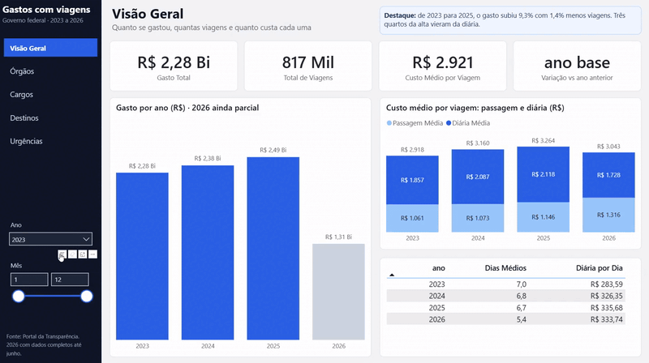
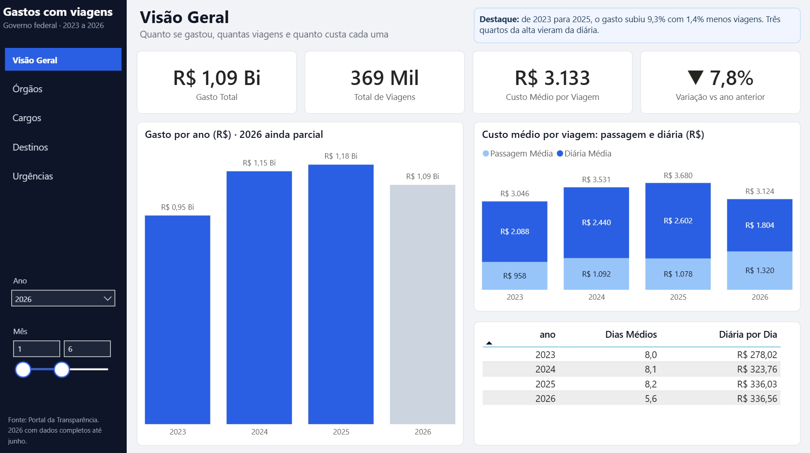

# Gastos do governo federal com viagens (2023 a 2026)

Analisei cerca de 2,9 milhões de viagens a serviço do governo federal, com dados abertos do Portal da Transparência, para entender quanto se gasta, onde esse dinheiro se concentra e o que mudou entre 2023 e 2026. Fiz a limpeza e as análises em Python e levei o resultado para um dashboard de cinco páginas no Power BI.

Veja também a [página do projeto no meu site](https://fernando-gali.pages.dev/projetos/viagens-governo/) e o [post sobre o erro que quase cometi](https://fernando-gali.pages.dev/blog/gastos-do-governo-com-viagens/) nessa análise.

## Pergunta

Quanto o governo federal gasta com viagens, quem gasta mais e o que mudou entre 2023 e 2026?

## Principais achados

- **O gasto subiu 9,3% de 2023 para 2025** (de R$ 2,28 bi para R$ 2,49 bi), mas o número de viagens caiu 1,4%. O que subiu foi o custo de cada viagem: +11,9%.
- **Três quartos desse aumento vieram das diárias.** As viagens até encurtaram, mas cada dia ficou 18% mais caro, com quase todo o salto de 2023 para 2024.
- **Em 2026, o gasto está 7,8% abaixo de 2025** (janeiro a junho). Comparando até agosto, a queda parecia o dobro, mas os meses mais recentes ainda não foram totalmente lançados.
- **O gasto é concentrado:** de 9 a 12 dos 35 órgãos somam 80% do total, dependendo do ano. O Ministério da Justiça e Segurança Pública ficou com cerca de um terço até 2025 e cai para 25% em 2026 (ainda parcial). Brasília sozinha responde por cerca de 14%. As viagens internacionais são 3% das viagens e 13% a 15% do gasto.
- **Quase 60% das viagens são marcadas como urgentes**, e elas não custam mais que as normais. O mais provável é que a marcação indique pedido feito com pouca antecedência, e não emergência.

## Como fiz

1. Uma função lê e limpa os quatro arquivos anuais da mesma forma.
2. Validei os dados antes de analisar: duplicadas, viagens canceladas, valores negativos e até que mês os dados de 2026 estão completos. Cada decisão está explicada no notebook.
3. Analisei o gasto por ano, órgão, cargo, destino e urgência, e separei o custo por viagem nos seus componentes.
4. O notebook gera tabelas resumidas na pasta `powerbi/`, que alimentam o dashboard (`dashboard_viagens.pbix`). Conferi os números do dashboard com os do notebook, um por um.

## Dashboard

São cinco páginas: visão geral, órgãos, cargos, destinos e urgências. Cada uma traz o principal achado escrito no topo, e os filtros de ano e mês valem para todas.

O filtro de mês é o que mostra o cuidado com 2026: comparando janeiro a agosto, o gasto parece 15,6% menor que em 2025; com os meses já fechados, a queda é de 7,8%.

## Limites

- Só 38% do gasto tem cargo identificado, e 85% das viagens têm destino identificado. O resto está em sigilo ou não foi informado.
- Os dados de 2026 são confiáveis só até junho.
- O significado da marcação de urgência e o reajuste das diárias são hipóteses que ainda precisam ser confirmadas.

## Dados pessoais

Os arquivos originais trazem nome e CPF (mascarado) de cada viajante. Tirei essas colunas logo na leitura e, quando precisei olhar por viajante, usei um número anônimo. Nenhum nome aparece no notebook.

## Como rodar

1. Baixe os arquivos de viagens a serviço de 2023 a 2026 no [Portal da Transparência](https://portaldatransparencia.gov.br/download-de-dados/viagens) e extraia os arquivos `2023_Viagem.csv`, `2024_Viagem.csv`, `2025_Viagem.csv` e `2026_Viagem.csv` na pasta `dados/`.
2. Instale as bibliotecas: `pip install -r requirements.txt`
3. Abra o `analise_oficial.ipynb` e rode todas as células. Ele também atualiza as tabelas da pasta `powerbi/`.
4. Para ver o dashboard, abra o `dashboard_viagens.pbix` no Power BI Desktop (Windows). Se mudar a pasta do projeto de lugar, atualize o caminho das tabelas em Transformar dados → Configurações da fonte de dados.

## Ferramentas

Python, pandas, NumPy, Jupyter e Power BI.